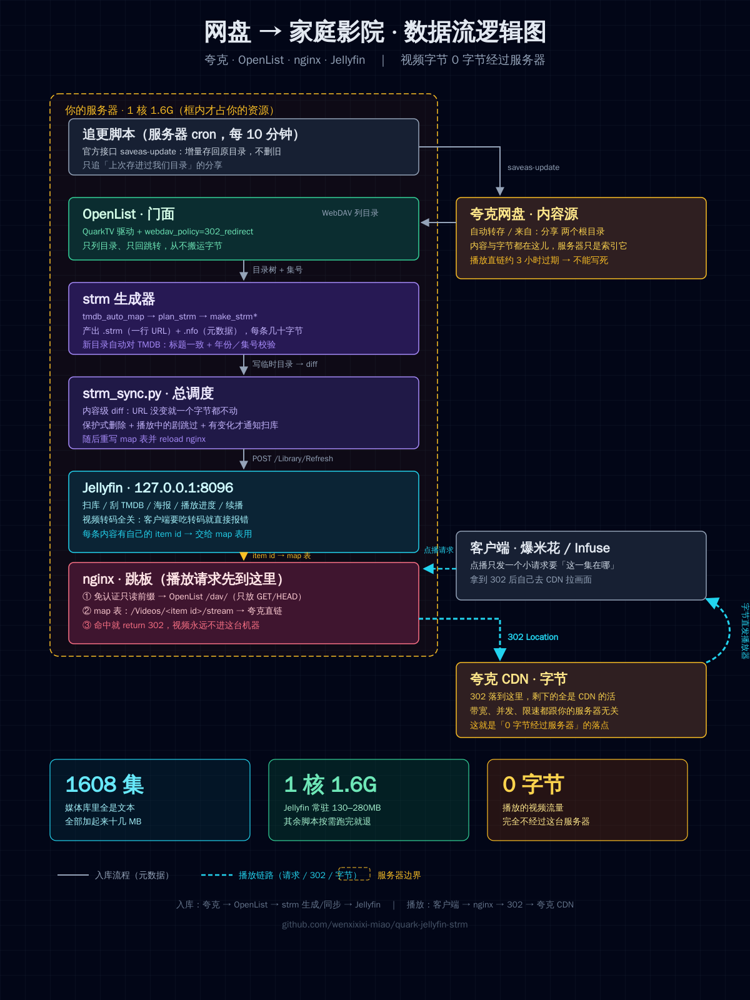

# quark-jellyfin-strm

把**夸克网盘**里的影视资源，变成带海报、集名、播放进度的 **Jellyfin** 媒体库，
而**视频字节一个都不经过你自己的服务器**：播放时 nginx 直接 302 到夸克 CDN。

> 一句话：夸克存内容，OpenList 做门面，nginx 做跳板，Jellyfin 做元数据，播放器直连 CDN。

## 它解决什么问题

网盘里的剧想用电视盒子/手机看，通常有三条烂路：

| 做法 | 问题 |
|---|---|
| 播放器直连 WebDAV | 没有变更通知，新增/改名都得手动重扫；命名乱一点的剧集识别全错 |
| 服务端代理转发 | 所有视频流量过你的 VPS，带宽和内存立刻爆 |
| 网盘搬家到本地盘 | 几百 GB，成本更高 |

这套方案的取舍是：**服务器只存文本**（每个条目一个 `.strm` + 一个 `.nfo`，1583 集也只有十几 MB），
**字节全走 CDN**（302），**元数据交给 TMDB**（Jellyfin 刮）。

## 架构

```
入库：分享链接 ─官方CLI增量转存─▶ 夸克/自动转存 ─WebDAV─▶ OpenList ─列目录─▶ strm 生成器 ─▶ /srv/media(只文本)
                                        │                                        │
                                        │                           Jellyfin 扫库 + 刮 TMDB
                                        │                                        │
播放：  播放器 ─/Videos/{id}/stream─▶ nginx ─302─▶ 夸克 CDN ─▶ 播放器        gen_strm_map.py
                                  （map 表: item id → 直链）                      │
                                                                        nginx conf.d map 文件
```



<sub>矢量版：<code>docs/architecture.svg</code>（GitHub 不渲染仓库里的 SVG，所以 README 用 PNG）</sub>

详细的分层职责、数据流和排障不变量见 [`docs/architecture.md`](docs/architecture.md)，
踩过的坑见 [`docs/pitfalls.md`](docs/pitfalls.md)。

## 依赖

- 一台 Linux VPS（实测 1 核 1.6G 内存足够：Jellyfin 常驻 130–280MB，其余脚本按需跑）
- [OpenList](https://github.com/OpenListTeam/OpenList) v4，装 [QuarkTV 驱动](https://github.com/OpenListTeam/OpenList)（扩展驱动）
- Jellyfin 10.x / 12.x
- nginx + certbot（两个域名：网盘入口、Jellyfin 入口）
- Python 3.10+（**只用标准库**，无需 pip 安装任何东西）
- 一个 TMDB API Key（免费）
- 一个能操作你夸克网盘的官方 CLI（本仓库假设它带 `get-share-update-list` / `saveas-update` 这类子命令，
  见 `scripts/quark_official_save.py`；没有的话先用 OpenList 手动放片，第 2、3 步照样能用）

## 快速开始

```bash
git clone https://github.com/<you>/quark-jellyfin-strm.git
cd quark-jellyfin-strm/scripts
cp config.example.json config.json && chmod 600 config.json
$EDITOR config.json          # 填 OpenList 账号、Jellyfin API Key、TMDB Key、域名前缀、路径
python3 strm_sync.py --dry   # 只统计不写盘，先确认能读到目录
python3 strm_sync.py         # 真正生成 strm + 通知 Jellyfin 扫库 + 重写 nginx map
```

`config.json` 里每一项都在 `config.example.json` 有注释；`public_base` 就是
`https://<网盘入口域名>/<nginx 私有路径前缀>`，strm 里写的就是它。

nginx 两个配置文件样例在 [`nginx/`](nginx/)：`openlist-play-entry.conf.example`（免认证只读前缀 + 注入 Basic）
和 `jellyfin.conf.example`（强制 302 + WebSocket 修法）。

定时任务样例在 [`deploy/crontab.example`](deploy/crontab.example)。

## 脚本一览

| 脚本 | 作用 |
|---|---|
| `quark_official_save.py` | 官方接口增量追更：只追「上次存进过我们目录」的分享，存回原目录 |
| `plan_strm.py` | 扫来源目录、解析集号、按 TMDB 季集数定季/集，产出 `plan.json` |
| `make_strm.py` | 按 `plan.json` 生成 `.strm` + `.nfo` |
| `make_strm_batch2.py` | 特殊剧（一部剧拆多部合集、剧场版归电影库）的定制映射 |
| `make_strm_share.py` | 第二个来源根目录（存量转存）的生成器，支持累计/多季/仅电影三种模式 |
| `make_strm_hermes.py` | 合集类电影的规则化映射（一个目录里 N 部电影） |
| `tmdb_auto_map.py` | **新目录自动配 TMDB**：置信度够了就自己建映射，不够就报给人 |
| `strm_sync.py` | 总调度：内容级 diff、保护式删除、播放闸门、通知扫库 |
| `gen_strm_map.py` | 由 Jellyfin 条目生成 nginx 302 map 并 reload |
| `cfg.py` | 集中配置，所有私有信息只从 `config.json` 读 |

## 新内容怎么进库

- **已配过映射的剧/片**：追更或你手动塞进来源目录 → 2 小时内自动生成 strm、入库、302 更新，无需人工。
- **全新作品**：`tmdb_auto_map.py` 先试自动：剧集要求「标题完全一致 + 本地最大集号 ≤ TMDB 总集数」，
  电影要求「标题完全一致 + 年份吻合」。通过就自己建映射；撞名（比如同名的老电影）或差个把字，
  就报一句等你确认——宁可漏一次，也不刮错片。

## 已知边界

- 视频**不解码不转码**：客户端要转码就报错。想支持转码得自己开，并把带宽算清楚。
- 首次扫库很慢（逐集远端 ffprobe），海报可能要单独刷 `ImageRefreshMode=FullRefresh`。
- 夸克转码流画质有损；源文件直链是原画但会被单线程限速。两者都 302、都不过服务器，自己权衡。
- 网盘链接有存活期，追更依赖官方接口；接口不覆盖的分享需要先手动存一次才会进白名单。

## License

MIT
